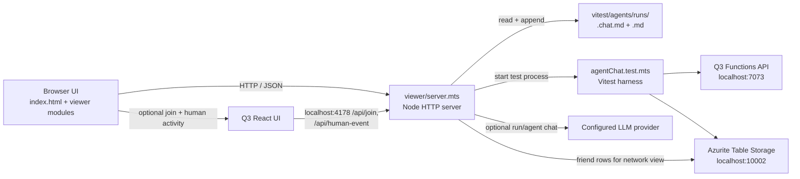

# Agent Lab Viewer Architecture

The Q3 Agent Lab viewer is a local monitoring and replay UI for the Quest3
agent-chat test harness. It is a small Node.js HTTP server plus browser-native
JavaScript modules; it is not part of the deployed React application. The
dashboard presents each run's activity, participants, metrics, findings, judge
results, relationships, questions, and chat in one interface.

## Runtime shape



The viewer listens on `127.0.0.1:4178` by default; `AGENT_VIEW_PORT` overrides
the port. Its process owns only the test-run state and child processes. Run
history is persisted as files under `vitest/agents/runs/`, while the Q3 API and
local Table Storage remain separate services.

## Browser UI

`index.html` provides the page structure and styles. It contains the top bar,
run list, run metrics, participant cards, view tabs, activity feed, detail
inspector, and chat panel. The screenshot corresponds to this layout.

The browser code is split by responsibility:

| File | Responsibility |
| --- | --- |
| `viewer.mts` | UI state, event handlers, one-second refresh, run/status loading, and view selection |
| `viewer-elements.mts` | Typed references to the page's DOM elements |
| `viewer-data.mts` | Run-log and report parsing, event kinds, finding classification, and question topics |
| `viewer-profiles.mts` | Participant cards, activity counts, and Agent/Human distinction |
| `viewer-questions.mts` | Question grouping from report and event data, sharing/answer status, and question rendering |
| `viewer-results.mts` | Overview, relationship/judge results, and friend-network rendering |

The browser polls run state, run history, selected run data, and status once a
second. It fetches the selected run's log, report, and friend-network data in
parallel, then renders only when the data signature changes. A run is marked
live while its log is recent; older runs are replayed from disk.

## Server and data flow

`server.mts` serves the static viewer assets and JSON endpoints:

| Endpoint | Use |
| --- | --- |
| `GET /api/run` | Current runner state |
| `GET /api/runs` | Available run log files, newest first |
| `GET /api/log?run=...` | Selected run's live/replay activity log |
| `GET /api/report?run=...` | Completed judge report, if available |
| `GET /api/network?run=...` | Current friend rows for participant profiles in the report |
| `POST /api/run` | Start a Vitest agent run |
| `POST /api/chat` | Ask the results assistant or a selected agent about a run |
| `POST /api/join` | Register a human participant from the local Q3 UI |
| `POST /api/human-event` | Append a human answer to the active run log |

Activity and completed results come from paired files: `<run>.chat.md` is the
incremental event stream and `<run>.md` is the final report. The viewer parses
these text formats in `viewer-data.mts`; it does not query Q3 for historical
run events. The People & friends view is different: the server reads participant
profile IDs from the report, initializes the existing Table Storage repository,
and requests each participant's current friend rows.

Starting a run invokes the root-workspace Vitest command for
`agentChat.test.mts`, with `AGENT_RUN=1` and values from the Functions project's
`local.settings.json`. The server starts Azurite Table Storage on port 10002
when it is not already listening, but requires the Q3 API on port 7073 to be
running. Run output is streamed to the server terminal as well as written to
run files.

The optional chat endpoint passes the selected run's report and recent chat log
to the configured LLM. For agent-persona chat it also reads that participant's
persona file server-side. Persona files are not served as static assets or
returned by a viewer API endpoint.

## Build and start

From the repository root:

```powershell
pnpm --dir module/quest3Tier/func run build
pnpm exec tsc --project module/quest3Tier/func/vitest/agents/tsconfig.json
node module/quest3Tier/func/dist/vitest/agents/viewer/server.mjs
```

The first TypeScript build compiles the Q3 Functions project. The second uses
the Agent Lab `tsconfig.json` to emit the harness and viewer modules beneath
`module/quest3Tier/func/dist/vitest/agents/`. At runtime the server loads
`index.html` from the source `viewer/` directory and serves the compiled
browser modules from `dist/`.

The Q3 API must already be running for a new test. Open
`http://127.0.0.1:4178`; the UI can also be started through the VS Code task or
`vitest/agents/run-ollama.ps1`. The latter checks local Ollama compatibility,
builds both projects, sets the local-model environment variables, and starts
the viewer. To run its lightweight parser and route-guard self-check after
building:

```powershell
node module/quest3Tier/func/dist/vitest/agents/viewer/server.mjs --check
```

## Boundaries and operational notes

- This is a local development observer, not an authenticated production
  monitoring service. The server binds to loopback and expects local Q3 and
  Azurite services.
- Viewer mutations require the viewer's same-origin request. The join and
  human-event routes accept only the local Q3 UI origins on port 5183 and set
  CORS headers for those origins.
- Run names are restricted to basenames ending in `.chat.md` and checked
  against discovered run files before reads, preventing path traversal through
  run selection.
- Starting a run is guarded against a concurrent active run; the harness also
  has its own run lock. The viewer disables its start button while the runner
  is active.
- The log and report are text interfaces shared with the harness. If their
  format changes, update the parser and its server `--check` assertions
  together.
